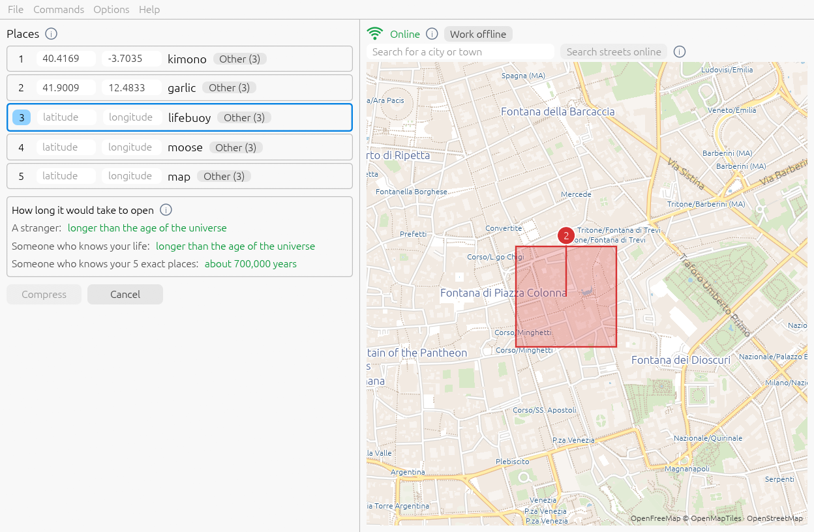
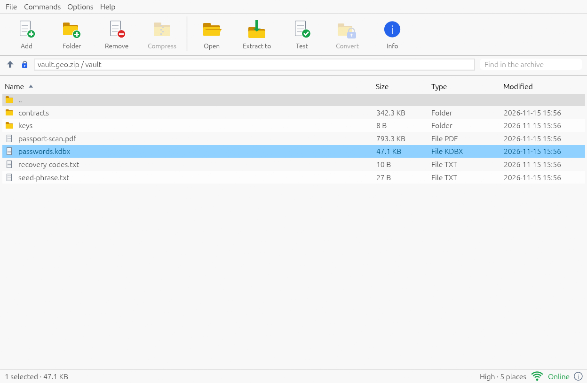
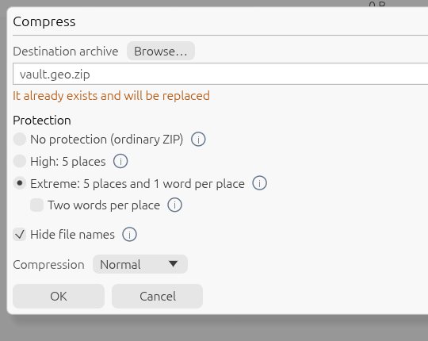
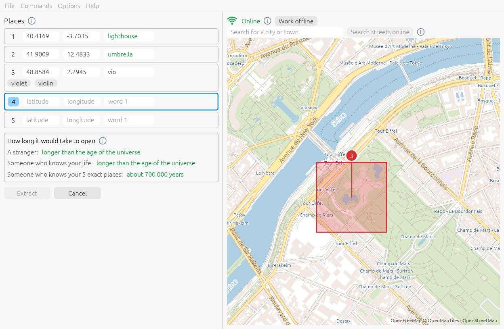
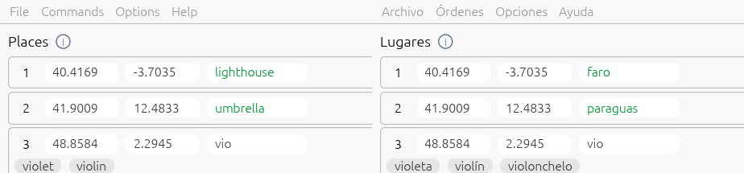

# GeoZip

GeoZip makes ordinary AES-256 ZIP archives whose key is not a password. The
key is five places on a map, in order, that only you know. At the highest
level the program also gives you one random word per place.



> **Experimental.** GeoZip has not been audited by anyone outside the project,
> the file format is still a draft, and the word list may change before 1.0.
> Until then, keep another copy of anything you put in a GeoZip archive.

## Who this is for

GeoZip is less convenient than typing a password. Opening an archive means
finding five places on a map again. It is not meant for the files you open
every day.

It is meant for the few things you need to keep for years, open rarely, and
cannot afford to lose to someone who gets hold of the file:

- a password manager database or an export of it
- wallet seed phrases and private keys
- two-factor recovery codes
- a journalist's source material or unpublished documents
- scans of passports, deeds, wills and contracts
- SSH and GPG keys
- medical or legal records
- a letter of instructions for your family

The trade is deliberate. A password strong enough for these is one most people
have to write down, and then the piece of paper is the weak point. GeoZip tries
to give you a secret that is strong and that stays in your head.

There is no recovery. If you forget a place, the order, or a word, nobody can
open the archive, including the author of this program.

## How it works

1. You pick five places in order. Each one snaps to a 300 m square, so you do
   not have to hit the exact spot again, only the same square. The program
   keeps you at least 75 m away from the edge of the square when you create the
   archive.
2. At the Extreme level the program picks one random word for each place (two
   if you ask for it). You memorise each word by picturing the object at that
   place.
3. The places, the words and a random salt stored in the file go through
   Argon2id, which is slow on purpose, and the result is the AES-256 key of a
   standard ZIP archive.

| Level | What you remember |
|---|---|
| High | 5 places |
| Extreme | 5 places and 1 word per place |
| Extreme, two words | 5 places and 2 words per place |

The full format is in [SPEC.md](SPEC.md). The threat model and known weak
points are in [SECURITY.md](SECURITY.md).

## Download

Builds for the latest release:

| System | File |
|---|---|
| Linux (x86-64) | [GeoZip-linux-x86_64.tar.gz](https://github.com/colocoquillo/GeoZip/releases/latest/download/GeoZip-linux-x86_64.tar.gz) |
| Windows (x86-64) | [GeoZip-windows-x86_64.zip](https://github.com/colocoquillo/GeoZip/releases/latest/download/GeoZip-windows-x86_64.zip) |
| macOS (Apple Silicon) | [GeoZip-macos-arm64.zip](https://github.com/colocoquillo/GeoZip/releases/latest/download/GeoZip-macos-arm64.zip) |

Each download contains the desktop application and the `geozip` command-line
tool. Nothing needs to be installed. Checksums are in `SHA256SUMS` on the
[releases page](https://github.com/colocoquillo/GeoZip/releases).

Things to know before you run them:

- The builds are made by GitHub Actions from this repository. Development and
  testing happen on Linux. The Windows and macOS builds have had very little
  testing, so please report what you find.
- The builds are not code-signed. Windows SmartScreen will warn you; choose
  "More info" and "Run anyway". On macOS, right-click the app and choose
  "Open", or allow it under System Settings > Privacy & Security.
- On Linux the application adds itself to your applications menu on first run
  so that the desktop shows its icon. You can undo this from Options > Remove
  from the applications menu.
- The Linux build needs glibc 2.35 or newer (Ubuntu 22.04 and later, or any
  distribution of similar age).

If you would rather not trust a download, [build it yourself](#building-from-source).

## Using it



The window works like a classic archiver: a toolbar, a file list and a status
bar.

### Protecting files

1. Click **Add** or **Folder**, or drop files on the window.
2. Click **Compress** and choose the destination and the protection level.
   "No protection" writes a plain ZIP.
3. Mark your five places, in order.
4. At the Extreme level, memorise the word shown next to each place. You can
   ask for a different word up to three times per place.



When it finishes, use **Test** to confirm you can open the archive before you
delete the originals. Test reads and decrypts everything without writing
anything to disk.

### Opening an archive

Click **Open**, then **Extract to**. The program asks for as many places and
words as the archive needs. Words autocomplete as you type.



While the archive stays open, GeoZip remembers the places you entered, so you
can extract a selection, add files or delete files without marking them again.
They are kept in memory only and forgotten when you close the archive.

### Where the coordinates come from

You can give a place in three ways:

- **Click on the map.** The blue square under the cursor is the 300 m cell you
  are about to choose.
- **Search.** Typing a city or town name searches a list of about 237,000
  places built into the program, without using the network. A separate button
  sends the text to an online search service to find streets and specific
  spots.
- **Type or paste coordinates.** Four decimals are enough (about 11 m). You
  can take them from anywhere: a GPS, a paper atlas, or Google Maps
  (right-click a point and click the coordinates to copy them, then paste them
  into the first box of a row).

Any online map knows what you looked at. If you copy coordinates from Google
Maps, Google sees those places. If you use GeoZip's online map, the map server
sees which areas you downloaded, about 2 km across, though not where you
clicked. The online search button sends the text you typed.

### Use the offline map for anything that matters

For the strongest result, work offline:

1. Choose **Work offline** above the map, or Options > Map > Offline. The
   indicator turns red and the program stops using the network.
2. Either type coordinates you already know, or load a map file. Help >
   Offline maps explains how to cut a `.pmtiles` map of your region out of the
   free Protomaps world map and roughly how big it will be (a large city is
   20 to 100 MB).

Getting the map file takes a command-line tool and a few minutes. It is the
least polished part of GeoZip, and it is worth doing once.

### Choosing places

- Do not use famous landmarks. The screenshots here use the Trevi Fountain and
  the Eiffel Tower because everyone recognises them, which is exactly why they
  are bad choices.
- Do not use your home, your workplace or anywhere printed on a document about
  you.
- Good places are specific spots tied to a memory nobody else has: the bench
  where something happened, the bend in a path, a particular shop that has
  since closed.
- An order you get for free helps: the order the events happened in.

### Converting a ZIP you already have

1. **Open** the existing ZIP. GeoZip shows its contents, and the status bar
   says whether it has a password.
2. Click **Convert**.
3. Choose a level. If the old ZIP has a password, type it in the same dialog.
4. Mark your places.

GeoZip writes a new archive next to the old one and leaves the original
untouched. It reads unencrypted ZIPs, the legacy ZipCrypto scheme and AES ZIPs.
Delete the original yourself once you have tested the new one.

## It is still a ZIP

A GeoZip archive is a standard ZIP with WinZip AES-256 encryption. The only
unusual thing is where the password comes from. That means:

- Any ZIP tool can list it, unless you chose to hide file names.
- 7-Zip, WinRAR and WinZip can extract it if you give them the derived key,
  so you are never locked into this program:

  ```sh
  geozip key vault.geo.zip
  7z x -p"<the key it prints>" vault.geo.zip
  ```

- GeoZip also opens, extracts, creates and edits ordinary ZIP files.

The salt and parameters live in the ZIP comment, with a copy in each entry in
case a tool strips the comment.

## How strong is it

Strength is measured in bits of entropy: each extra bit doubles the number of
guesses an attacker needs.

- The planet has about 5.7 billion 300 m cells, so one cell chosen at random is
  worth 32 bits. Five of them in order are worth 162 bits.
- The word list has 1,850 concepts, so one random word is worth about 11 bits.
  Five words add 54 bits; five pairs add 103 bits.
- Every guess has to go through Argon2id with 256 or 512 MiB of memory, about
  one second on a desktop computer. An attacker cannot make that step cheap.

The places are the honest weak point: people do not choose at random. So the
real number depends on who is attacking.

| Level | On paper | Stranger | Someone who knows your life | They know your 5 exact places |
|---|---|---|---|---|
| High | 162 bits | 75–120 | 30–60 | 0 |
| Extreme | 216 bits | 119–174 | 74–114 | 44–54 |
| Extreme, two words | 256 (key size) | 168–223 | 123–163 | 93–103 |

The first and last columns are arithmetic. The two in the middle are estimates
of how predictably people pick places; they are not measurements.

In time, for an attacker with 1,000 computers guessing non-stop:

| Bits left to guess | Time |
|---|---|
| 30 | about 12 days |
| 54 | about 700,000 years |
| 75 | about 90 times the age of the universe |

So High is only as good as your places are private. Extreme stays out of reach
even if someone learns every one of your places, because the words were chosen
by the program and cannot be researched.

### Compared with a seed phrase

A 12-word seed phrase carries 128 bits and a 24-word one carries 256, all of it
uniformly random.

On paper, Extreme (216 bits) sits between the two. In practice a seed phrase is
stronger in the worst case, because none of it depends on human choice, while
GeoZip guarantees 54 bits (103 with two words) and gets the rest from how well
you chose your places. GeoZip claws some of that back with a much slower key
derivation: a seed phrase guess costs about a millisecond, a GeoZip guess costs
about a second.

The reason to use GeoZip anyway is the other half of the problem. Almost nobody
memorises twelve unrelated words, so seed phrases get written down, and then
their security is the security of a piece of paper. Five places and five
objects are within what an ordinary person can keep in their head for years.

## Why places are easier to remember

Human memory is poor at arbitrary data and very good at places and events.
GeoZip leans on three well-known effects:

- **Spatial and episodic memory.** You already remember where things happened
  to you. You are not learning a new secret, only choosing among memories.
- **The method of loci.** Attaching an object to a location is the oldest
  memory technique there is. "A lighthouse in the middle of that square" is one
  image, not a place plus a word.
- **Concrete nouns.** Every word in the list is a physical thing you can
  picture. There are no abstract words.

Location-based secrets have been studied before; GeoPass (Thorpe, MacRae and
Salehi-Abari, 2013) found that people remembered a single map location well.
GeoZip has not been through a user study of its own.

## Words in your language

The word list is the same set of 1,850 concepts in every language, and what
goes into the key is the concept's number, not its spelling. An archive made
with "faro" opens with "lighthouse".



English and Spanish are included. Adding a language means adding a column to
[`wordlist/gz1-concepts.tsv`](wordlist/gz1-concepts.tsv), which never changes
existing archives. Translations and corrections are welcome; the rules a word
has to meet are checked by `tools/check_wordlist.py`.

## Command line

The `geozip` tool does the same things without a window. Its messages are
currently in Spanish only.

```sh
# Protect a folder at the High level. Without --places it asks for them.
geozip create vault.geo.zip ./documents --places "40.4169,-3.7035;41.9009,12.4833;..."

# Extreme level with hidden file names. It prints the words it generated.
geozip create vault.geo.zip ./documents --level extremo --hide-names --lang en

# Two words per place.
geozip create vault.geo.zip ./documents --level extremo --two-words

# Show the public part of an archive.
geozip info vault.geo.zip

# Open it.
geozip open vault.geo.zip -o ./out --places "..." --words "lighthouse;umbrella;..." --lang en

# Convert an ordinary ZIP.
geozip migrate old.zip new.geo.zip --old-password "..."

# Plain ZIP, no protection.
geozip create --plain plain.zip ./documents

# Print the derived AES key, to open the archive with another tool.
geozip key vault.geo.zip
```

Coordinates are `latitude,longitude` in decimal degrees. What you type after
`--places` and `--words` may end up in your shell history; leave them out and
the program asks for them instead.

## Building from source

You need stable [Rust](https://rustup.rs), a C compiler and CMake.

```sh
git clone https://github.com/colocoquillo/GeoZip.git
cd GeoZip
cargo build --release
```

The two programs end up in `target/release/`: `geozip-gui` and `geozip`.

To run the tests:

```sh
cargo test --workspace
python3 tools/check_wordlist.py
```

The tests include one that has 7-Zip open a GeoZip archive with the derived
key, if 7-Zip is installed.

```
SPEC.md                    File format
SECURITY.md                Threat model and known weak points
wordlist/gz1-concepts.tsv  The 1,850 concepts, in English and Spanish
assets/                    Icon, map styles, offline place list
crates/geozip-core/        Grid, key derivation, ZIP reading and writing
crates/geozip-cli/         Command-line tool
crates/geozip-gui/         Desktop application
tools/                     Scripts that check and build the data files
```

## Limitations

- No independent audit yet.
- The format is a draft. If the word list changes before 1.0, Extreme-level
  archives made earlier will stop opening. About 130 entries are still flagged
  for review by a native speaker.
- Without "hide file names", the names, sizes and dates of your files are
  visible to anyone who has the archive.
- With "hide file names", the whole contents pass through memory, so the
  archive cannot be larger than your free RAM.
- ZIP authenticates each file, not the archive as a whole. Someone who can
  modify an archive with visible names can delete or rename entries. They
  cannot read or alter the contents.
- You cannot drag files out of the window; use Extract.
- The interface is in English and Spanish. Command-line and error messages are
  in Spanish only.
- macOS builds are for Apple Silicon only.

## If you build on this idea

The idea of a place-based key is free to use, and so is the code, under the MIT
licence. If you make something of your own around it, I would appreciate a
mention of GeoZip as the inspiration and a link back here. Share it wherever
you like.

Bug reports, translations and security reviews are all welcome through the
[issue tracker](https://github.com/colocoquillo/GeoZip/issues). For anything
that would let someone read other people's archives, please see
[SECURITY.md](SECURITY.md) first.

## Licence and credits

MIT. See [LICENSE](LICENSE).

- Map data: [OpenStreetMap](https://www.openstreetmap.org/copyright)
  contributors, served by [OpenFreeMap](https://openfreemap.org) in the
  OpenMapTiles schema.
- Offline place list: [GeoNames](https://www.geonames.org), CC BY 4.0.
- Online street search: [Photon](https://photon.komoot.io).
- Map styles: OpenFreeMap Bright and Protomaps Light, as shipped with the
  [walkers](https://github.com/podusowski/walkers) map widget.
